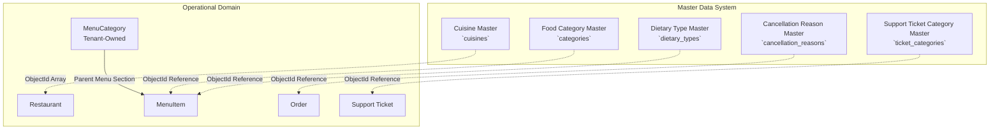
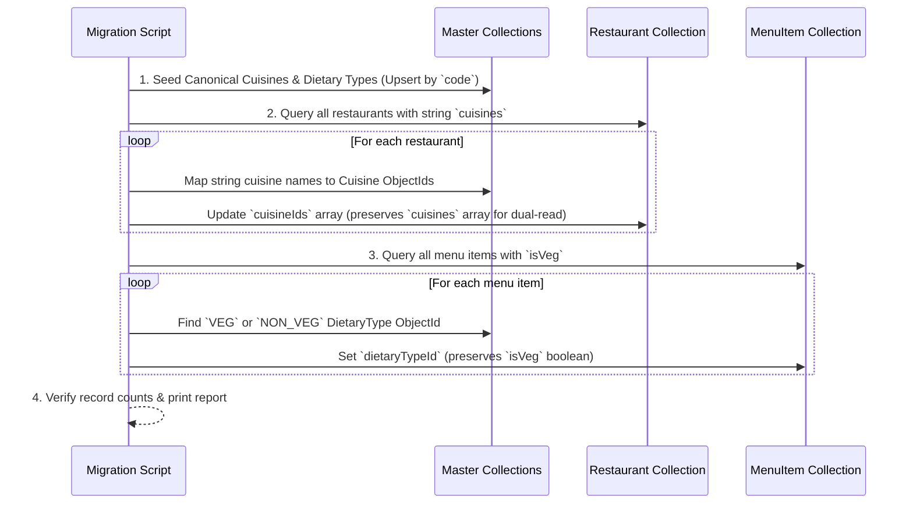

# Production-Grade Master Data Architecture & Implementation Plan
**Platform:** Ftafat Multi-Vendor Food & Hyperlocal Delivery Platform  
**Architect:** Senior Software Architect & Full-Stack Engineer  
**Date:** October 2026  
**Status:** Approved for Implementation  

---

## Executive Summary

The Ftafat food delivery platform currently handles reference data through a mix of unvalidated string arrays (`cuisines: ['Italian', 'Pizza']`), binary boolean flags (`isVeg: true/false`), hardcoded checkout constants (`const deliveryFeePaise = 3000`), fragmented category definitions (`image` vs `iconUrl`, `order` vs `sortOrder`), and unstandardized freeform cancellation strings.

This document establishes an industry-standard, production-grade **Master Data Architecture** following domain-driven database design, multi-tenant safety, backward-compatible dual-read/dual-write schemas, and reactive TanStack Query frontend integration.

---

## 1. Deep Codebase Audit Findings

### 1.1 Existing Models & Data Flow Audit

| Domain Entity | Current Implementation | Files & Locations | Identified Architectural Flaws |
| :--- | :--- | :--- | :--- |
| **Cuisines** | Loose string array `cuisines: [{ type: String }]` | `backend/src/modules/restaurants/restaurant.model.js:43`<br>`frontend/app/(owner)/profile.tsx:50-65` | Inconsistent casing (`North Indian` vs `north indian`), typo propagation, hardcoded array `POPULAR_CUISINES` in frontend. Cannot rename cuisines or track analytics reliably. |
| **Dietary Types** | Binary boolean `isVeg: Boolean` | `backend/src/modules/menu/menuItem.model.js:34`<br>`backend/src/modules/catalog/catalogItem.model.js:30` | Cannot represent **Vegan**, **Eggitarian**, **Jain Veg**, or **Halal**. Restricts filtering and customer dietary safety. |
| **Food Categories** | Fragmented Schema: `Category` model exists in `catalog`, re-exported in `admin`. | `backend/src/modules/catalog/category.model.js`<br>`backend/src/modules/admin/admin.service.js:237-256`<br>`frontend/app/(admin)/categories.tsx` | Schema mismatch: `catalog/category.model.js` expects `slug`, `iconUrl`, `sortOrder`, while `admin.service.js` inserts `{ name, image, order }` without `slug`. Admin frontend edits `image` and `order`. |
| **Menu Categories** | Restaurant-scoped `MenuCategory` | `backend/src/modules/menu/menuCategory.model.js` | **Correctly scoped** to individual restaurants (`restaurant: ObjectId`). Must be preserved as restaurant-owned collections. |
| **Cancellation Reasons** | Freeform text strings | `backend/src/modules/orders/order.controller.js:46`<br>`frontend/app/order/[id].tsx:80` | Hardcoded strings (`'User requested cancellation from details'`). No auditability, no analytics on cancellation causes, no role-based filtering (Customer vs Merchant vs Rider). |
| **Fee Configuration** | Dual implementation: `FeeConfig` model in admin vs hardcoded values in checkout | `backend/src/modules/admin/feeConfig.model.js`<br>`backend/src/modules/checkout/checkout.service.js:94-95` | `FeeConfig` exists in DB, but `checkout.service.js` ignores it and hardcodes flat ₹30 delivery fee and ₹15 packaging fee. |
| **Support Ticket Categories** | Hardcoded Mongoose Schema enum | `backend/src/modules/support/ticket.model.js:53` | `enum: ['order_issue', 'payment_issue', ...]` cannot be extended or reordered by platform administrators without code redeployment. |
| **Order & Payment Statuses** | State Machine String Constants | `backend/src/common/constants/orderStatuses.js`<br>`backend/src/modules/orders/order.stateMachine.js` | **Correctly implemented as state machine enums**. Must NOT be converted into dynamic master tables. |

---

## 2. Master Data System Design & Principles

### 2.1 Centralized Base Master Schema Pattern

All platform-governed master collections must adhere to a standardized, normalized schema contract:

```typescript
interface IBaseMaster {
  _id: mongoose.Types.ObjectId;   // Immutable system identity
  code: string;                   // Normalized uppercase business code (e.g. 'NORTH_INDIAN', 'VEGAN')
  name: string;                   // User-facing display name (e.g. 'North Indian', 'Vegan')
  description?: string;           // Optional business description
  iconUrl?: string;               // Vector SVG or WebP URL
  isActive: boolean;              // Soft status toggle (default: true)
  sortOrder: number;              // Display sequence (default: 0)
  metadata?: Record<string, any>; // Domain-specific extensible attributes
  createdAt: Date;
  updatedAt: Date;
  createdBy?: mongoose.Types.ObjectId;
  updatedBy?: mongoose.Types.ObjectId;
}
```

### 2.2 Core Architectural Principles

1. **Immutable ObjectId Relationships:** All references in operational collections (`Restaurant`, `MenuItem`, `Order`, `SupportTicket`) must reference master records via MongoDB `ObjectId`.
2. **Stable Normalized Business Codes:** Unique indexes on `code` (e.g. `{ code: 1 }, { unique: true }`). Code validation: uppercase regex `/^[A-Z0-9_]{2,50}$/`.
3. **Display Name Independence:** Changing `name` (e.g. from "Pure Veg" to "Vegetarian") modifies only the master record and immediately reflects everywhere without running data migrations or breaking historical links.
4. **Soft Deactivation (`isActive`):** Inactive masters (`isActive: false`) cannot be selected for new restaurants or menu items, but existing historical relations remain intact.
5. **No Blind Masterization:** Operational state machines (`ORDER_STATUS`, `PAYMENT_STATUS`, `DELIVERY_STATUS`) remain compiled constants. Operational rules (geo-fencing polygons, dynamic surge equations) remain specialized domain engines.

---

## 3. Master Entities: Classification Matrix

### 3.1 Entities Approved for Master Data Architecture



#### Detailed Entity Specifications:

1. **`Cuisine` Master (`backend/src/modules/masters/cuisine.model.js`):**
   - Codes: `NORTH_INDIAN`, `SOUTH_INDIAN`, `ITALIAN`, `CHINESE`, `BIRYANI`, `FAST_FOOD`, `DESSERTS`, `BEVERAGES`, `MUGHLAI`, `CONTINENTAL`.
   - Referenced by: `Restaurant.cuisineIds: [{ type: ObjectId, ref: 'Cuisine' }]`.
   - Dual-read compatibility: `Restaurant.cuisines: [String]` maintained via Mongoose virtual / hook.

2. **`DietaryType` Master (`backend/src/modules/masters/dietaryType.model.js`):**
   - Codes: `VEG` (Vegetarian), `NON_VEG` (Non-Vegetarian), `VEGAN` (Vegan), `EGGETARIAN` (Contains Egg), `JAIN` (Jain Vegetarian).
   - Attributes: `colorCode` (`#059669` for Veg, `#DC2626` for Non-Veg, `#16A34A` for Vegan, `#D97706` for Egg), `badgeIcon`.
   - Referenced by: `MenuItem.dietaryTypeId: { type: ObjectId, ref: 'DietaryType' }`.
   - Dual-read compatibility: `MenuItem.isVeg: Boolean` computed automatically from DietaryType code (`code === 'VEG' || code === 'VEGAN' || code === 'JAIN'`).

3. **`FoodCategory` Master (`backend/src/modules/catalog/category.model.js`):**
   - Unified & sanitized schema: `name`, `code`, `slug`, `iconUrl`, `sortOrder`, `isActive`, `vertical: ['food', 'grocery', 'both']`.
   - Global catalog taxonomy for customer discovery and search filters.
   - Distinct from `MenuCategory` (which is restaurant-specific e.g. "Chef's Signature Pizzas").

4. **`CancellationReason` Master (`backend/src/modules/masters/cancellationReason.model.js`):**
   - Scopes: `CUSTOMER`, `RESTAURANT`, `RIDER`, `ADMIN`.
   - Codes:
     - Customer: `ORDERED_BY_MISTAKE`, `DELIVERY_TIME_TOO_LONG`, `CHANGE_DELIVERY_ADDRESS`, `FORGOT_TO_ADD_ITEMS`.
     - Restaurant: `ITEM_OUT_OF_STOCK`, `KITCHEN_OVERLOADED`, `RESTAURANT_CLOSING`, `PRICING_ERROR`.
     - Rider: `VEHICLE_BREAKDOWN`, `EXTREME_WEATHER`, `UNREACHABLE_CUSTOMER`.
   - Attributes: `requiresRemarks: Boolean`, `triggersAutoRefund: Boolean`.

5. **`TicketCategory` Master (`backend/src/modules/masters/ticketCategory.model.js`):**
   - Replaces static schema enum in `ticket.model.js`.
   - Codes: `ORDER_DELAYED`, `ITEMS_MISSING`, `FOOD_QUALITY`, `BILLING_ISSUE`, `PAYMENT_FAILED`, `RIDER_BEHAVIOR`.

### 3.2 Entities Intentionally Excluded from Database Masters

| Candidate | Status | Reason & Architectural Guardrail |
| :--- | :--- | :--- |
| **Order Statuses** | **EXCLUDED** | Strict finite state machine in `order.stateMachine.js`. Arbitrary admin additions would bypass inventory, payment capture, and delivery lifecycle guarantees. |
| **Payment Statuses** | **EXCLUDED** | Governed by Razorpay/UPI gateway webhooks and financial ledger audit invariants. |
| **Delivery Statuses** | **EXCLUDED** | Real-time GPS dispatch engine state machine (`UNASSIGNED` -> `ASSIGNED` -> `PICKED_UP` -> `DELIVERED`). |
| **Delivery Zones & Surge** | **EXCLUDED** | Requires GeoJSON polygon spatial indexing (`2dsphere`) and dynamic mathematical pricing algorithms. |
| **Coupons & Promotions** | **EXCLUDED** | Operational marketing entities with min order value, discount caps, usage limits, and expiration dates. Already handled by `Coupon` module. |

---

## 4. Multi-Vendor & Tenant Safety Invariants

1. **RBAC Isolation:**
   - Platform Admin (`ROLES.ADMIN`): Exclusive permission to Create, Update, Reorder, and Deactivate Master Data records via `/api/v1/admin/masters/*`.
   - Restaurant Owners (`ROLES.RESTAURANT_OWNER`): Can **read** active master records (`GET /api/v1/masters/*`) and associate their restaurant/menu items with master ObjectIds. Cannot create or alter master records.
   - Customers & Public: Can **read** active masters for discovery, search filtering, and cancellation reason selection.
2. **Server-Side Ownership Enforcement:**
   - When a restaurant owner updates their cuisines or menu items, the server verifies `restaurant.owner.equals(req.user.id)`. The client-supplied `restaurantId` is cross-verified against the authenticated owner profile.
3. **Referential Integrity Validation:**
   - Any API payload containing `cuisineIds`, `dietaryTypeId`, or `cancellationReasonId` is validated against the active master records. Attempts to reference nonexistent or inactive IDs return HTTP 422 with a descriptive error code `INVALID_MASTER_REFERENCE`.

---

## 5. API Architecture & DTO Specifications

### 5.1 Public / Operational Read Endpoints

```http
GET /api/v1/masters/cuisines
GET /api/v1/masters/dietary-types
GET /api/v1/masters/food-categories?vertical=food
GET /api/v1/masters/cancellation-reasons?role=customer
```

- **Query Parameters:** `search`, `includeInactive` (false by default for public), `vertical`.
- **Response Format:**
```json
{
  "success": true,
  "data": [
    {
      "_id": "67096d2b5f1234567890abcd",
      "code": "NORTH_INDIAN",
      "name": "North Indian",
      "iconUrl": "https://cdn.ftafat.com/cuisines/north_indian.webp",
      "sortOrder": 1,
      "isActive": true
    }
  ]
}
```

### 5.2 Admin Master Management Endpoints

```http
GET    /api/v1/admin/masters/:masterType
POST   /api/v1/admin/masters/:masterType
GET    /api/v1/admin/masters/:masterType/:id
PATCH  /api/v1/admin/masters/:masterType/:id
DELETE /api/v1/admin/masters/:masterType/:id
PUT    /api/v1/admin/masters/:masterType/reorder
```

- Supported `:masterType`: `cuisines`, `dietary-types`, `categories`, `cancellation-reasons`, `ticket-categories`.
- **Security:** `authenticate`, `requireRole([ROLES.ADMIN])`.
- **Audit Logging:** Every creation, update, and deactivation is recorded in `auditLog.model.js` with admin ID, timestamp, IP, before/after diff.

---

## 6. Frontend TanStack Query Architecture

### 6.1 Query Key Factory Pattern (`frontend/hooks/useMasterQueries.ts`)

```typescript
export const masterKeys = {
  all: ['masters'] as const,
  lists: () => [...masterKeys.all, 'list'] as const,
  list: (type: string, params?: Record<string, any>) =>
    [...masterKeys.lists(), type, params] as const,
  details: () => [...masterKeys.all, 'detail'] as const,
  detail: (type: string, id: string) =>
    [...masterKeys.details(), type, id] as const,
};
```

### 6.2 Hooks Implementation Plan

1. **`useMasterListQuery(type, params)`**:
   - `staleTime: 1000 * 60 * 10` (10 minutes for master data).
   - Deduplicates requests across navbar navigation.
2. **`useCreateMasterMutation(type)`**:
   - On success: `queryClient.invalidateQueries({ queryKey: masterKeys.list(type) })`.
3. **`useUpdateMasterMutation(type)`**:
   - Optimistic updates + query invalidation.
4. **`useToggleMasterStatusMutation(type)`**:
   - Instant activation toggle without full page refetch.

---

## 7. Admin Dashboard: Unified Master Data Hub

### Screen Design: `frontend/app/(admin)/master-data.tsx`

1. **Top Segmented Switcher:**
   - `🥘 Cuisines` | `🥗 Dietary Types` | `📂 Food Categories` | `🚫 Cancellation Reasons` | `🏷️ Fee Settings`
2. **Live Controls:**
   - Instant search filter by Code or Name.
   - "+ Add New Master" modal with code auto-generation (typing "North Indian" automatically suggests code `NORTH_INDIAN`).
   - Active/Inactive toggle switch per row.
   - Drag/Step sort order editor.
3. **Clean Empty & Error States:**
   - Validation banners on duplicate codes (`CODE_ALREADY_EXISTS`).

---

## 8. Data Migration & Dual-Read Compatibility Plan

### 8.1 Migration Script: `backend/scripts/migrations/migrate-master-data.js`



### 8.2 Safe Dual-Read / Dual-Write Verification

- **Dual-Read in Backend DTOs:**
  ```javascript
  // Restaurant Schema virtual or pre-save hook
  restaurantSchema.pre('save', async function() {
    if (this.isModified('cuisineIds') && this.cuisineIds?.length > 0) {
      const Cuisine = mongoose.model('Cuisine');
      const docs = await Cuisine.find({ _id: { $in: this.cuisineIds } });
      this.cuisines = docs.map(d => d.name);
    }
  });
  ```
- **Result:** Existing mobile app views (`r.cuisines?.join(', ')`) continue to render flawlessly with zero customer downtime.

---

## 9. Phased Implementation Roadmap

### Phase 1: Master Schemas & Centralized Engine (Backend)
- [ ] Create `backend/src/modules/masters/` directory:
  - `master.schema.js` (Re-usable base schema helper with indexes and code validation).
  - `cuisine.model.js`.
  - `dietaryType.model.js`.
  - `cancellationReason.model.js`.
  - `master.service.js` (Centralized CRUD, code uniqueness, soft-delete, reordering).
  - `master.controller.js`.
  - `master.routes.js`.
- [ ] Update `backend/src/modules/catalog/category.model.js` to adhere to Master standard (`code`, `name`, `iconUrl`, `sortOrder`).
- [ ] Register routes in `backend/src/routes/index.js` (`/masters` public, `/admin/masters` protected).

### Phase 2: Schema References & Fee Config Hookup
- [ ] Update `Restaurant` schema: add `cuisineIds: [{ type: ObjectId, ref: 'Cuisine' }]`.
- [ ] Update `MenuItem` schema: add `dietaryTypeId: { type: ObjectId, ref: 'DietaryType' }`.
- [ ] Update `Order` schema: add `cancellationReasonId: { type: ObjectId, ref: 'CancellationReason' }`.
- [ ] Update `checkout.service.js`: replace hardcoded `3000` & `1500` fees with dynamic lookup from `FeeConfig`.

### Phase 3: Idempotent Migration Script
- [ ] Develop `backend/scripts/migrations/migrate-master-data.js`.
- [ ] Execute migration in dry-run mode, then apply to MongoDB database.
- [ ] Validate referential integrity across 100% of restaurants and menu items.

### Phase 4: Frontend Services, Hooks & Admin Hub
- [ ] Create `frontend/services/master.service.ts`.
- [ ] Create `frontend/hooks/useMasterQueries.ts` with TanStack Query key factory.
- [ ] Create `frontend/app/(admin)/master-data.tsx` (Unified Master Management screen).
- [ ] Update `frontend/app/(owner)/profile.tsx` to fetch dynamic cuisines from `/masters/cuisines`.
- [ ] Update `frontend/app/order/[id].tsx` cancellation modal to use dynamic cancellation reasons.

### Phase 5: Verification, Tests & Documentation
- [ ] Write integration test suite: `backend/tests/masters.test.js`.
- [ ] Verify TypeScript build (`npx tsc --noEmit`).
- [ ] Verify Expo app and Node server without errors.

---

## 10. Risk Management & Rollback Strategy

1. **Non-Destructive Dual Writing:** Old fields (`cuisines`, `isVeg`, `cancellationReason`) are NOT dropped. They are kept in sync during all operations.
2. **Instant Rollback:** If a regression occurs, the system can revert to legacy string reads without database rollbacks or data loss.
3. **Database Backup:** Run MongoDB collection dump prior to Phase 3 migration.
